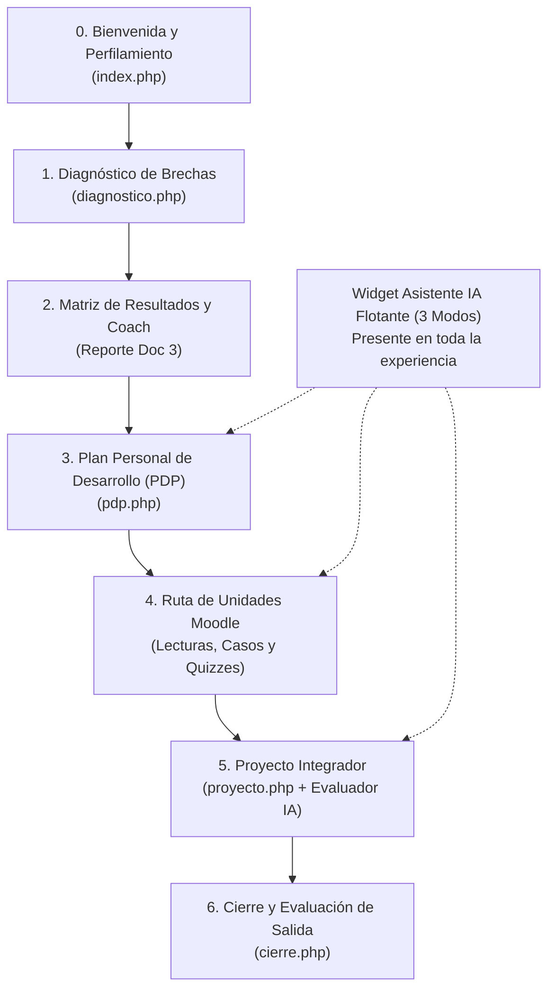
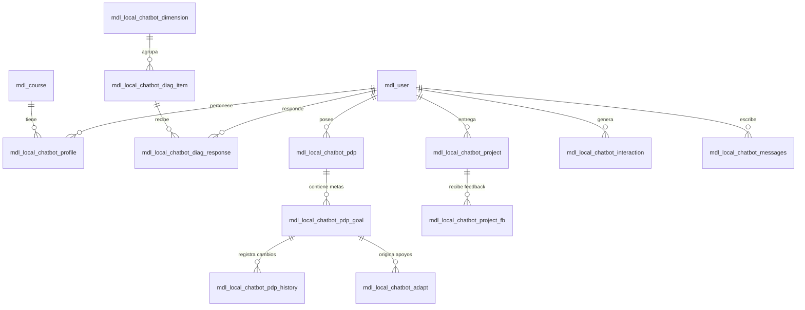

# Guía Completa de Funcionamiento del Sistema y Conexión de Bases de Datos
**Asistente IA — Módulo 1 (`local_chatbot` M1-v1.2.0)**  
*SENCE / Interfases Consultores*

---

## 🗺️ Índice Rápido
1. [¿Qué es esta aplicación y para qué sirve?](#1-qué-es-esta-aplicación)
2. [El Recorrido del Usuario paso a paso (El Viaje Pedagógico)](#2-el-recorrido-del-usuario)
3. [El Asistente de Inteligencia Artificial: Sus 3 Modos ("Sombreros")](#3-el-asistente-de-ia-y-sus-3-modos)
4. [¿Cómo funciona por debajo? (Arquitectura Técnica y Flujo de un Mensaje)](#4-cómo-funciona-por-debajo)
5. [Estructura de la Base de Datos (Tablas y Relaciones)](#5-estructura-de-la-base-de-datos)
6. [Cómo conectar o integrar información externa de los cursos (Bases de Datos)](#6-cómo-conectar-información-externa-de-cursos)
7. [Glosario y Resumen de Archivos Clave](#7-resumen-de-archivos-clave)

---

## 1. ¿Qué es esta aplicación?

Esta aplicación es una **plataforma de autoaprendizaje adaptativo para facilitadores y relatores de capacitación**, implementada como un plugin dentro de **Moodle 5.0+**.

### El Propósito Central
En lugar de ser un curso tradicional donde todos los alumnos leen exactamente lo mismo de forma lineal, este sistema:
1. **Diagnostica** las competencias metodológicas del facilitador al ingresar.
2. **Calcula una Matriz Individual de Brechas** (detecta en qué áreas es fuerte y en cuáles necesita apoyo).
3. **Le ayuda a crear un Plan Personal de Desarrollo (PDP)** con metas a su medida.
4. **Le acompaña durante el curso con un Asistente de IA** que adopta 3 roles distintos (Tutor pedagógico, Coach motivacional y de metas, y Evaluador de proyectos).
5. **Ofrece microactividades adaptativas** según el progreso real.
6. **Mide el aprendizaje final** mediante un diagnóstico de salida para ver cuánto mejoró.

---

## 2. El Recorrido del Usuario (El Viaje Pedagógico)

Para entender la aplicación sin perderse, imagínate el camino que recorre un profesor o relator (el usuario alumno) desde que entra hasta que termina el curso:



### Paso 0: Bienvenida, Perfilamiento y Consentimiento (`index.php`)
- **Qué ve el usuario:** Una pantalla donde ingresa su perfil profesional (años de experiencia, si hace clases presenciales u online, su sector productivo, y cuántas horas a la semana tiene disponibles).
- **El Consentimiento Ético:** Se le explica claramente que interactuará con Inteligencia Artificial (Claude, Gemini u OpenAI), qué datos se usan y se le pide su aceptación explícita.
- **Regla de seguridad:** Si el usuario no acepta el consentimiento, el Asistente IA se mantiene bloqueado.

### Paso 1: Diagnóstico de Entrada (`diagnostico.php`)
- **Qué ve el usuario:** Un instrumento de evaluación de competencias con dos tipos de preguntas:
  - *Declarativas:* En escala de 1 a 5 ("En mi práctica habitual, yo realizo retroalimentación...").
  - *Situacionales:* Casos reales de aula con 4 alternativas donde hay una decisión metodológicamente correcta.
- **Durante el diagnóstico:** El Asistente IA está activo en modo "Fase Diagnóstico". Puede explicar conceptos técnicos ("¿qué es una rúbrica?"), pero tiene prohibido sugerir alternativas o adelantar resultados.

### Paso 2 y 3: Resultados y Plan Personal de Desarrollo (`pdp.php`)
- **El Cálculo:** El backend calcula el **Puntaje Compuesto** ($70\%$ su práctica declarada + $30\%$ su acierto en casos situacionales) y clasifica sus dimensiones en 4 niveles:
  1. *Prioridad alta* (brecha urgente).
  2. *En desarrollo*.
  3. *Funcional*.
  4. *Consolidado* (fortaleza).
- **La Salida del Coach:** El Coach genera un informe estructurado que le propone hasta 3 metas de desarrollo.
- **Autonomía del Facilitador:** El usuario decide: puede *Aceptar*, *Modificar*, *Postergar* o *Rechazar* cada meta propuesta. Nada se le impone.

### Paso 4: Las Unidades de Estudio (Moodle estándar)
- El alumno avanza por los contenidos del curso (Unidades 1 a 4: lecturas, videos, cuestionarios).
- En cualquier momento abre el Asistente en **Modo Tutor** para resolver dudas conceptuales. El tutor usa preguntas socráticas y le indica qué lecturas consultar.

### Paso 5: Proyecto Integrador (`proyecto.php`)
- El participante redacta y sube su trabajo final de aplicación práctica.
- Actúa el **Modo Evaluador Formativo**: la IA analiza el proyecto contra una rúbrica pública (criterio por criterio), destacando fortalezas, aspectos a mejorar y cómo se vincula con su PDP.
- **Importante:** La IA nunca califica con nota sumativa (eso es rol del docente humano); solo entrega orientación formativa.

### Paso 6: Cierre del Módulo (`cierre.php`)
- Vuelve a contestar el instrumento de diagnóstico (etapa "salida").
- El sistema compara entrada vs. salida y le muestra su crecimiento.

---

## 3. El Asistente de IA y sus 3 Modos ("Sombreros")

El asistente vive en un widget flotante en la esquina inferior derecha. Aunque es un solo chat, cambia de "personalidad" y de acceso a datos según el modo seleccionado:

```
┌─────────────────────────────────────────────────────────────┐
│                       ASISTENTE IA                          │
├───────────────┬─────────────────────────────┬───────────────┤
│  MODO TUTOR   │         MODO COACH          │ MODO EVALUADOR│
│ (Pedagógico)  │      (Metas y Apoyo)        │ (De Proyectos)│
├───────────────┼─────────────────────────────┼───────────────┤
│ Resuelve      │ Analiza tu diagnóstico,     │ Revisa tu     │
│ dudas sobre   │ te ayuda a cumplir tus      │ proyecto      │
│ lecturas,     │ metas del PDP y propone     │ contra la     │
│ conceptos y   │ microactividades prácticas  │ rúbrica y te  │
│ cuestionarios.│ basadas en evidencias.      │ da feedback.  │
└───────────────┴─────────────────────────────┴───────────────┘
```

### La Matriz de Acceso (Privacidad Estricta)
Para que el bot no mezcle cosas ni alucine:
- El **Tutor** NO puede ver las notas de tus proyectos ni adelantarte las respuestas de cuestionarios pendientes.
- El **Coach** solo ve tus brechas de diagnóstico y tus metas; no ve tus textos de proyecto.
- El **Evaluador** solo ve la rúbrica y tu borrador de proyecto; no opina sobre tu plan de desarrollo.

---

## 4. ¿Cómo funciona por debajo?

### El Viaje de un Mensaje (Frontend a Backend y a la IA)

```
Navegador del Usuario (Widget JS)
   │
   │ 1. Envía mensaje + modo activo (Tutor/Coach/Evaluador)
   ▼
ajax.php (Servidor Moodle)
   ├─ 2. Valida sesión del usuario y consentimiento
   ├─ 3. Pseudonimiza los datos (elimina RUT, nombres reales, emails)
   ├─ 4. assistant::build_context() → arma el prompt con los datos autorizados
   ├─ 5. guardrails::sanitize_input() → previene inyecciones o jailbreaks
   ▼
provider_factory (Gateway Multi-Proveedor)
   │
   ├─ ¿Cuál proveedor está configurado en Moodle?
   ├──► Gemini API (Google)
   ├──► Claude API (Anthropic)
   └──► OpenAI API (GPT-4o / Azure)
   ▼
Respuesta de la IA (JSON o Texto)
   │
   ▼
ajax.php (Filtros de Salida - Guardrails)
   ├─ ¿Intentó dar una nota o calificación definitiva? ──► Se bloquea (GR-05)
   ├─ ¿Intentó revelar respuestas de cuestionarios? ─────► Se bloquea (GR-01)
   ├─ ¿Usó lenguaje descalificador ("no sabes")? ────────► Se corrige (GR-10)
   ├─ Registra interacción, tokens y fuentes en BD
   ▼
Navegador del Usuario
   └─ Muestra la respuesta en pantalla + lista de fuentes bibliográficas consultadas
```

---

## 5. Estructura de la Base de Datos

Todas las tablas del plugin se almacenan en la base de datos de Moodle con el prefijo `mdl_local_chatbot_*`.

### Diagrama Entidad-Relación Simplificado



### Detalle de las Tablas Principales

| Tabla en BD | ¿Qué guarda? | Campos clave |
|---|---|---|
| `mdl_local_chatbot_profile` | Perfil del alumno y si aceptó el consentimiento de IA. | `userid`, `courseid`, `rol`, `experiencia`, `tiempo`, `consentaccepted` |
| `mdl_local_chatbot_dimension` | Las competencias que se evalúan (ej. Planificación, Evaluación). | `code`, `name`, `criterios`, `courseid` |
| `mdl_local_chatbot_diag_item` | Las preguntas del diagnóstico (declarativas y situacionales). | `dimensionid`, `statement`, `kind`, `options`, `correctoption` |
| `mdl_local_chatbot_diag_response` | Las respuestas que dio cada alumno en entrada y salida. | `userid`, `itemid`, `dimensionid`, `score`, `stage` ('entrada' o 'salida') |
| `mdl_local_chatbot_pdp` | La cabecera del Plan Personal de Desarrollo de cada usuario. | `userid`, `courseid`, `status` ('borrador', 'validado'), `version` |
| `mdl_local_chatbot_pdp_goal` | Las metas de desarrollo individuales (hasta 3 activas). | `pdpid`, `brecha`, `objetivo`, `acciones`, `plazo`, `evidencia`, `status` |
| `mdl_local_chatbot_pdp_history` | Auditoría inmutable de quién aceptó, modificó o postergó una meta. | `goalid`, `action`, `actor`, `justification`, `timecreated` |
| `mdl_local_chatbot_adapt` | Apoyos adaptativos (microactividades prácticas acordadas). | `goalid`, `userid`, `title`, `status`, `evidence_summary` |
| `mdl_local_chatbot_project` | El proyecto final que subió el alumno. | `userid`, `courseid`, `title`, `content`, `status`, `version` |
| `mdl_local_chatbot_project_fb` | La evaluación del Evaluador formativo por criterio de rúbrica. | `projectid`, `criterio`, `fortaleza`, `mejora`, `accion`, `pdpvinculo` |
| `mdl_local_chatbot_interaction` | Auditoría de uso de IA (telemetría, costos, tokens, tiempos). | `userid`, `mode`, `provider`, `model`, `prompt_tokens`, `completion_tokens` |
| `mdl_local_chatbot_messages` | El historial de conversación del chat. | `userid`, `courseid`, `mode`, `sender` ('user' o 'bot'), `message` |
| `mdl_local_chatbot_kb` | Base documental de lecturas y contenidos del curso para el Tutor. | `title`, `content`, `category`, `courseid` |

---

## 6. Cómo conectar información externa de cursos (Bases de Datos)

Si en el proyecto van a **subir información a una base de datos** y necesitas conectar esos cursos o sincronizar datos, existen **3 formas estándar de resolverlo**:

### Escenario A: Subir los datos directamente a la Base de Datos de Moodle (Recomendado para contenidos y preguntas)
Si la información que van a subir son:
- Nuevos cursos o usuarios matriculados.
- Nuevas preguntas o dimensiones para el diagnóstico.
- Recursos bibliográficos para el Tutor.

👉 **Cómo se hace:**
1. No necesitas crear conexiones raras. Se ejecutan scripts en PHP (en la carpeta `cli/`) o tareas programadas de Moodle (`scheduled tasks`).
2. El script usa el objeto nativo de base de datos de Moodle:
   ```php
   global $DB;
   // Insertar una nueva dimensión en un curso específico
   $record = new stdClass();
   $record->courseid = $curso_id;
   $record->code = 'D5';
   $record->name = 'Evaluación Formativa Avanzada';
   $DB->insert_record('local_chatbot_dimension', $record);
   ```

### Escenario B: Conectar Moodle a una Base de Datos Externa (MySQL / SQL Server / Postgres)
Si la información de los cursos se sube a un servidor externo (por ejemplo, una base de datos central de SENCE o de la empresa) y Moodle necesita leerla en vivo:

👉 **Cómo se hace:**
Moodle tiene soporte nativo para conectarse a bases de datos secundarias usando la clase `moodle_database` o PDO directo:
```php
// En classes/external_sync.php:
$external_db = moodle_database::get_driver_instance('mysqli', 'native');
$external_db->connect(
    'servidor-externo.sence.cl', // Host
    'usuario_lectura',            // User
    'clave_segura',               // Pass
    'bd_cursos_sence',            // Base de datos
    ''                            // Prefijo
);

// Consultar cursos externos:
$cursos = $external_db->get_records_sql("SELECT codigo_curso, nombre, relator FROM cursos_activos");
```

### Escenario C: Integración mediante Servicios Web / API REST (Arquitectura Limpia)
Si los otros sistemas de la Suite necesitan extraer o empujar información del Módulo 1 (brechas, estado de avance, PDPs):

👉 **Cómo se hace:**
El plugin ya cuenta con el contrato de exportación preparado en [`classes/suite_export.php`](file:///c:/ProyectoSence/moodle-latest-502/moodle/public/local/chatbot/classes/suite_export.php):
- `suite_export::for_user_layer($userid)`: Devuelve el perfil y el estado del PDP en formato JSON limpio.
- `suite_export::for_analytics_layer()`: Devuelve los indicadores anonimizados para tableros tipo PowerBI / Grafana.
- `suite_export::for_institutional_management()`: Devuelve el resumen para reportes de gestión institucional.

---

## 7. Resumen de Archivos Clave

| Carpeta / Archivo | ¿Para qué sirve? |
|---|---|
| `index.php` | Portada del curso, bienvenida, perfilamiento y consentimiento. |
| `diagnostico.php` | Cuestionario de entrada y salida con cálculo automático de brechas. |
| `pdp.php` | Interfaz del Plan Personal de Desarrollo, metas y microactividades. |
| `proyecto.php` | Entrega del proyecto integrador y visualización de la rúbrica. |
| `cierre.php` | Evaluación de salida, contraste de progreso y cierre de curso. |
| `indicadores.php` | Panel de control con gráficos y analítica para coordinadores. |
| `ajax.php` | El "cerebro" que recibe los mensajes del chat y conversa con la IA. |
| `classes/assistant.php` | Define las reglas de los 3 modos y arma el contexto. |
| `classes/ai/provider_factory.php` | Conecta con Google Gemini, Anthropic Claude, OpenAI o Azure. |
| `classes/guardrails.php` | Sistema de defensas éticas y seguridad contra malas respuestas. |
| `db/install.xml` | El plano de todas las tablas de base de datos del plugin. |
| `cli/` | Scripts de consola para verificar cálculos y sincronizar datos. |

---

> 💡 **Consejo para no perderse:**  
> Siempre piensa que **Moodle maneja el curso clásico** (usuarios, contraseñas, lecturas y notas formales) y este **plugin (`local_chatbot`) es el copiloto inteligente** que maneja el diagnóstico, el plan de metas personalizado, el chat de apoyo y la analítica de brechas. Todo lo que hace el plugin está ligado al `userid` del alumno y al `courseid` del curso.
